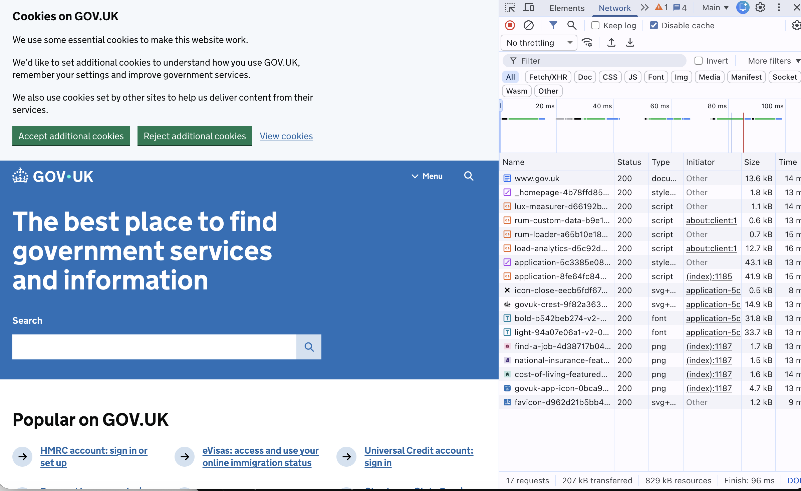
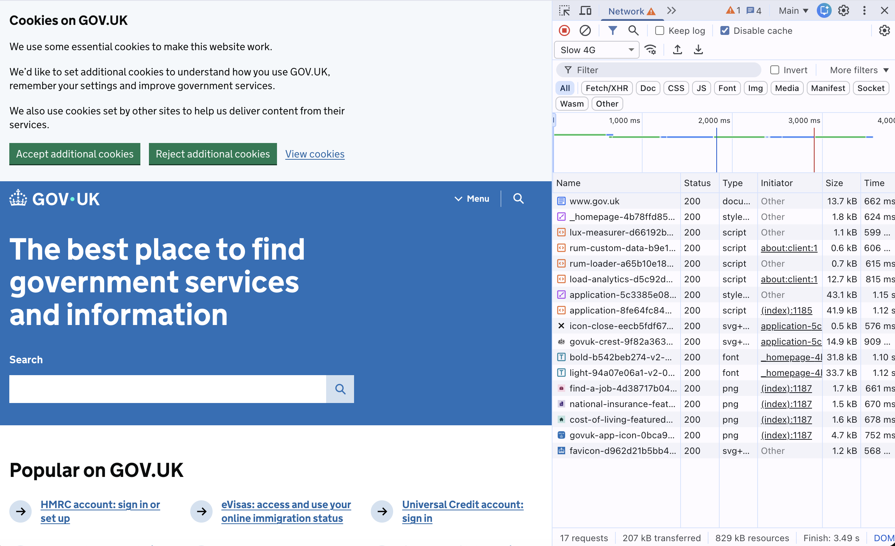
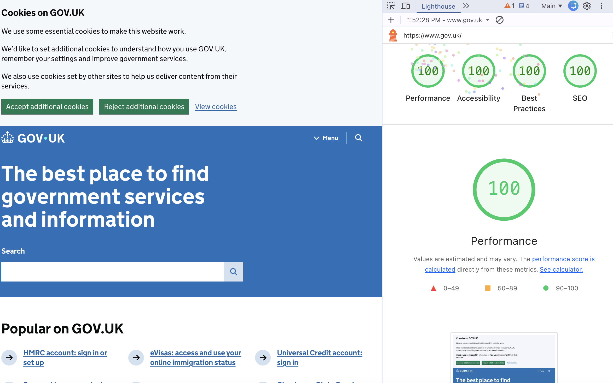

# EPA 1 Part A · Delivery Report: GOV.UK

Author: Edgars Zeltmanis · Site analysed: https://www.gov.uk/ (home page)
Tools: Chrome DevTools (Network, Lighthouse), `curl`, `dig`, WAVE · Measured: 24 Oct and 11 Nov 2026

## 1. From URL to page

| Step | What happens | Evidence |
|---|---|---|
| DNS | `www.gov.uk` is a CNAME to Fastly's CDN; resolves to `151.101.0.144` (+3 more) | `dig +short www.gov.uk` |
| Redirects | `http://gov.uk/` → `301` → `https://gov.uk/` → `301` → `https://www.gov.uk/` | `curl -I` |
| Connection | HTTP/2 over TLS (HTTPS) | `curl -w %{http_version}` |
| Timing (curl, Munich, warm DNS) | DNS 3 ms · connect 8 ms · TLS 17 ms · first byte 26 ms | `curl -w` |
| Response | `200`, served from the CDN cache (`x-cache: HIT`, `via: varnish`) | `curl -I` |

_Your explanation:_ TODO, in your own words: what each step does and why the redirects exist.

## 2. Main request and response headers

`curl -I https://www.gov.uk/`

| Header | Value | What it means |
|---|---|---|
| status | `HTTP/2 200` | TODO |
| content-type | `text/html; charset=utf-8` | TODO |
| cache-control | `max-age=300, public` | TODO |
| x-cache / age | `HIT` / `97` | TODO |
| vary | `Accept-Encoding` | TODO |
| strict-transport-security | `max-age=31536000; preload` | TODO |
| content-security-policy | `default-src 'self'; …` (allows only gov.uk + Google Analytics) | TODO |
| x-content-type-options | `nosniff` | TODO |
| x-frame-options | `SAMEORIGIN` | TODO |

Status codes seen: `200` home page · `301` redirects above · `404` for https://www.gov.uk/this-does-not-exist

## 3. Totals

| Measure | Value | Source |
|---|---|---|
| Requests on first load (no cache) | 17 | DevTools Network |
| Home page HTML | 85 KB uncompressed · 11 KB compressed on the wire | `curl` |
| Total transferred / uncompressed | 207 kB / 829 kB · Finish 96 ms | DevTools Network bottom bar (Disable cache on) |
| Largest file | `application.css`, 43.1 kB (then `application.js` 41.9 kB, fonts 33.7 + 31.8 kB) | DevTools Network, Size column |
| Same load on Slow 4G | 17 requests · 207 kB · Finish 3.49 s (vs 96 ms unthrottled, about 36× slower). Biggest files take longest: `application.css` 1.15 s, fonts 1.10–1.12 s | DevTools throttling: Slow 4G |
| Lighthouse (24 Oct and again 11 Nov) | Performance 100 · Accessibility 100 · Best Practices 100 · SEO 100 | DevTools Lighthouse |

Requests by type: 1 HTML · 2 CSS · 5 JS · 4 PNG · 2 fonts (woff2) · 3 SVG (incl. favicon)

_Your explanation:_ TODO, what the numbers say and what changes on Slow 4G.

## 4. Third parties

- First load, before any cookie choice: **0 third-party requests**. All 17 come from `www.gov.uk`.
- Fonts are self-hosted, not loaded from Google Fonts.
- The CSP allows Google Analytics / Tag Manager, but they only load after "Accept additional cookies".
- The cookie banner offers "Reject" and "Accept" as equal buttons.

_Your explanation:_ TODO, why this matters for privacy and speed.

## 5. Render-blocking resources

| Resource | Where | Blocks first paint? |
|---|---|---|
| `application-….css` | `<head>`, `media="all"` | Yes |
| `_homepage-….css` | `<head>`, `media="all"` | Yes |
| `lux-measurer.js`, `rum-loader.js` | `async` | No |
| `rum-custom-data.js`, `load-analytics.js`, `application.js` | `type="module"` (deferred by default) | No |

_Your explanation:_ TODO, why CSS blocks rendering and scripts here do not.

## 6. Screenshots

## 7. Conclusion

_Your explanation:_ TODO, 3 to 4 sentences: why GOV.UK is delivered well, and one thing that could be better
(images are PNG, not WebP/AVIF).
