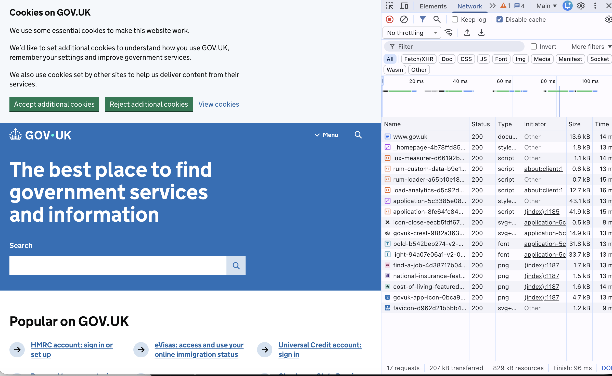
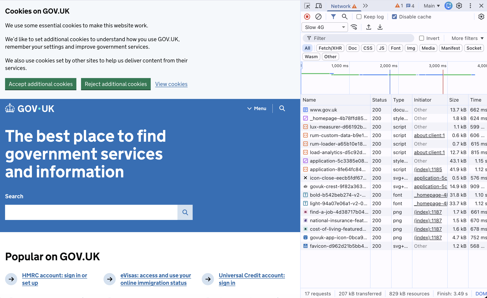
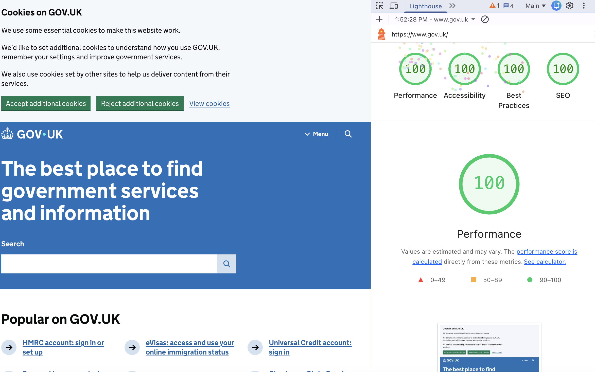

# EPA 1 Part A · Delivery Report: GOV.UK

Author: Edgars Zeltmanis · Site analysed: https://www.gov.uk/ (home page)
Tools: Chrome DevTools (Network, Lighthouse), `curl`, `dig`, WAVE · Measured: 24 Oct and 11 Nov 2026

## 1. From URL to page

| Step | What happens | Evidence |
|---|---|---|
| DNS | `www.gov.uk` is a CNAME to Fastly's CDN; resolves to `151.101.0.144` (+3 more) | `dig +short www.gov.uk` |
| Redirects | `http://gov.uk/` → `301` → `https://gov.uk/` → `301` → `https://www.gov.uk/` | `curl -I` |
| Connection | HTTP/2 over TLS (HTTPS) | `curl -w %{http_version}` |
| Timing (curl, Munich, warm DNS) | DNS 3 ms · connect 8 ms · TLS 17 ms · first byte 26 ms | `curl -w` |
| Response | `200`, served from the CDN cache (`x-cache: HIT`, `via: varnish`) | `curl -I` |
| Rendering | Browser parses HTML into the DOM and CSS into the CSSOM, combines them, then layout (positions and sizes) and paint (pixels on screen) | DevTools Performance; see section 5 for what blocks it |

**Explanation:** DNS turns `www.gov.uk` into the address `151.101.0.144`, so the browser knows which server to connect to.
The redirects exist for two reasons: HTTPS is more secure than HTTP, and people can type the simpler
address (`gov.uk`, without `https://` or `www`) and still end up on the one real site.

## 2. Main request and response headers

`curl -I https://www.gov.uk/`

| Header | Value | What it means |
|---|---|---|
| status | `HTTP/2 200` | The request worked |
| content-type | `text/html; charset=utf-8` | The file is an HTML page, in UTF-8 text |
| cache-control | `max-age=300, public` | Browser and caches may keep a copy for 300 s (5 min) |
| x-cache / age | `HIT` / `97` | Served from a nearby CDN copy, not gov.uk's own server; the copy was 97 s old |
| vary | `Accept-Encoding` | Separate cached copies for compressed and uncompressed responses |
| strict-transport-security | `max-age=31536000; preload` | The browser must always use HTTPS for this site, for one year |
| content-security-policy | `default-src 'self'; …` (allows only gov.uk + Google Analytics) | Only scripts from allowed places can run, which blocks injected code |
| x-content-type-options | `nosniff` | The browser must trust the content-type and not guess |
| x-frame-options | `SAMEORIGIN` | Other sites cannot put gov.uk in a frame, which stops clickjacking |

Status codes seen: `200` home page · `301` redirects above · `404` for https://www.gov.uk/this-does-not-exist

## 3. Totals

| Measure | Value | Source |
|---|---|---|
| Requests on first load (no cache) | 17 | DevTools Network |
| Home page HTML | 85 KB uncompressed · 11 KB compressed on the wire | `curl` |
| Total transferred / uncompressed | 207 kB / 829 kB · Finish 96 ms | DevTools Network bottom bar (Disable cache on) |
| Largest file | `application.css`, 43.1 kB (then `application.js` 41.9 kB, fonts 33.7 + 31.8 kB) | DevTools Network, Size column |
| Same load on Slow 4G | 17 requests · 207 kB · Finish 3.49 s (vs 96 ms unthrottled, about 36× slower). Biggest files take longest: `application.css` 1.15 s, fonts 1.10–1.12 s | DevTools throttling: Slow 4G |
| Lighthouse (24 Oct and again 11 Nov) | Performance 100 · Accessibility 100 · Best Practices 100 · SEO 100 | DevTools Lighthouse |
| Works without JavaScript | Yes: the raw HTML (no JS run) already contains the h1, the "Popular on GOV.UK" links (107 links in total) and a search form that submits to `/search/all` | `curl -s https://www.gov.uk/` |

Requests by type: 1 HTML · 2 CSS · 5 JS · 4 PNG · 2 fonts (woff2) · 3 SVG (incl. favicon)

**Explanation:** 207 kB transferred but 829 kB of resources means the files are compressed on the way,
about 4× smaller. On Slow 4G the same 207 kB takes 3.49 s instead of 96 ms: on a slow connection the
speed depends on the network, not on how small the page is. A small page still helps, because people
on slow mobile networks wait for every kilobyte.

## 4. Third parties

- First load, before any cookie choice: **0 third-party requests**. All 17 come from `www.gov.uk`.
- Fonts are self-hosted, not loaded from Google Fonts.
- The CSP allows Google Analytics / Tag Manager, but they only load after "Accept additional cookies".
- The cookie banner offers "Reject" and "Accept" as equal buttons.

**Explanation:** Privacy: nobody tracks you unless you agree, because no third-party code runs before
the cookie choice. Speed: there are no extra servers to connect to, so no extra DNS lookups and TLS
handshakes.

## 5. Render-blocking resources

| Resource | Where | Blocks first paint? |
|---|---|---|
| `application-….css` | `<head>`, `media="all"` | Yes |
| `_homepage-….css` | `<head>`, `media="all"` | Yes |
| `lux-measurer.js`, `rum-loader.js` | `async` | No |
| `rum-custom-data.js`, `load-analytics.js`, `application.js` | `type="module"` (deferred by default) | No |

**Explanation:** The browser won't paint the page until it knows the styles, otherwise you would see
a flash of unstyled content. That is why the 2 CSS files block. The scripts are `async` or `module`, so
they load in the background and don't hold up the first paint.

## 6. Screenshots

## 7. Peer check (11 Nov)

A classmate reviewed the draft (review comment on pull request #4). Feedback and what I changed:

| Feedback | Change |
|---|---|
| "From URL to page" stops at the response; add rendering | Added a Rendering row (DOM, CSSOM, layout, paint) to section 1 |
| "Works without JavaScript" needs a test | Added a curl test to section 3: content and search form are in the HTML before any JS runs |
| Finish includes late background requests; DOMContentLoaded / Load are more accurate | Noted: Finish (96 ms / 3.49 s on Slow 4G) is the time until the last request ended, including late analytics. DOMContentLoaded and Load are the better "page is usable" times |

## 8. Conclusion

GOV.UK is delivered well because a government site should be accessible for all people: it is small
(207 kB), fast (96 ms, Lighthouse 100) and works on slow connections and without JavaScript. A government
should not show advertising or track people, and GOV.UK loads no third parties before you agree.
It is also secure, with HTTPS forced by HSTS and a Content-Security-Policy.
One thing could be better: the images are PNG and could use smaller file types like WebP or AVIF.
